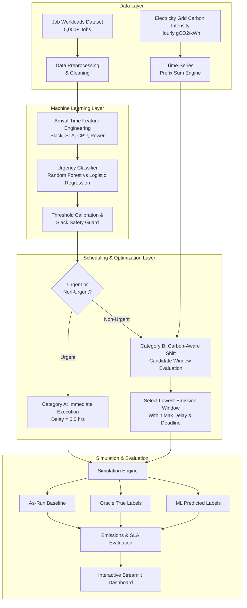

# Carbon-Aware Data Center Job Classification and Scheduling Using Machine Learning

An end-to-end cloud computing optimization framework that minimizes data center carbon emissions by intelligently classifying job urgency with machine learning and shifting flexible workloads into cleaner grid electricity windows.

---

## 1. System Architecture & Core Principles



### Core Design Principles
1. **Decoupled Classification and Scheduling:**
   - Urgent jobs (real-time APIs, financial transactions, tight SLAs) execute immediately upon arrival.
   - Prioritizing urgent jobs does **not** directly reduce carbon emissions; emissions savings occur when non-urgent jobs are shifted to cleaner grid periods.
   - The classifier predicts urgency strictly from workload operational characteristics, never from future carbon intensity.
2. **Energy Invariance Principle:**
   - Total electrical energy consumed (kWh) is strictly constant across all scheduling strategies.
   - Carbon savings result entirely from cleaner grid power mix timing (e.g., solar midday troughs and wind baseload).
3. **Asymmetric Risk & False Negative Mitigation:**
   - Misclassifying an urgent job as non-urgent (false negative) could cause costly SLA breaches.
   - The system utilizes class weighting, calibrated low decision thresholds, and hard deadline-slack safety guards.

---

## 2. Directory Structure

```text
carbon_aware_scheduler/
│
├── data/
│   ├── jobs.csv                      # Workload dataset (5,000+ jobs)
│   └── carbon_intensity.csv          # Hourly grid carbon intensity (gCO2/kWh)
│
├── models/
│   └── urgency_classifier.joblib     # Serialized ML pipeline & model artifact
│
├── src/
│   ├── data_generator.py             # Synthetic workload & carbon intensity generator
│   ├── preprocessing.py              # Data cleaning, validation, & chronological split
│   ├── feature_engineering.py        # Arrival-time feature extraction & Scikit-learn transformer
│   ├── train_model.py                # Logistic Regression & Random Forest training & thresholding
│   ├── predict.py                    # Inference service with SLA slack safety override
│   ├── scheduler.py                  # Carbon-aware window minimization scheduler
│   ├── emissions.py                  # Piecewise continuous O(1) prefix integration engine
│   ├── simulator.py                  # Multi-strategy comparative execution simulator
│   └── evaluation.py                 # Summary metrics, SLA compliance, & reporting
│
├── dashboard/
│   └── app.py                        # Streamlit 7-section interactive dashboard
│
├── tests/
│   ├── test_classifier.py            # Unit tests for ML models, inference & safety guards
│   ├── test_scheduler.py             # Unit tests for zero-delay urgency & deadline compliance
│   └── test_emissions.py             # Unit tests for energy conservation & integral calculation
│
├── outputs/
│   ├── scheduling_results.csv        # Detailed per-job scheduling decisions
│   ├── emissions_comparison.csv      # Strategy comparison summary table
│   └── classification_metrics.csv    # Supervised classification metrics
│
├── requirements.txt                  # Python dependencies
├── README.md                         # Project documentation
└── main.py                           # End-to-end command-line runner
```

---

## 3. Installation & Quickstart

### Prerequisites
- Python 3.11+
- Virtual environment (recommended)

### 1. Install Dependencies
```bash
pip install -r requirements.txt
```

### 2. Run the Complete End-to-End Pipeline
```bash
python main.py
```
This single command executes:
1. Workload generation (`5,000` jobs) and carbon intensity generation (`240` hours / 10 days).
2. Data preprocessing and chronological train/test split.
3. Training and calibration of Logistic Regression and Random Forest models.
4. Three-strategy simulation (Baseline vs Oracle True-Labels vs ML-Predicted Labels).
5. Output generation in `outputs/` and formatted CLI summary table.

### 3. Launch the Interactive Streamlit Dashboard
```bash
streamlit run dashboard/app.py
```
Open your browser at `http://localhost:8501` to explore:
- **Executive KPIs**: Real-time emissions savings and job distributions.
- **ML Performance**: Interactive confusion matrix and feature importances.
- **Carbon Intensity Dynamics**: Diurnal profiles and peak/trough bands.
- **Gantt Timeline**: Visual execution window shift by workload type.
- **Emissions Bar & Cumulative Charts**: Total and time-series carbon reductions.
- **Delay & SLA Analysis**: Non-urgent delay histograms and false-negative monitoring.
- **Interactive Controls**: Live sliders for max delay, decision threshold, and safety slack.

### 4. Run Test Suite
```bash
pytest tests/
```

---

## 4. Module Implementation Details

### `src/data_generator.py`
- **Workloads (`generate_workloads`)**: Generates 5,000+ realistic jobs spanning 9 workload archetypes (Real-time APIs, Financial transactions, Interactive user services, Database maintenance, Backups, Batch analytics, ML training, Log processing, Report generation).
- **Multi-Factor Ground Truth Urgency Model**: Combines SLA tier, deadline slack ratio, user priority, dependency count, and Gaussian operational noise without simplistic 1:1 rules.
- **Carbon Intensity (`generate_carbon_intensity`)**: Models diurnal solar generation ("duck curve" troughs at 11:00-15:00), evening peaker ramps (17:00-22:00), and day-to-day weather variance.

### `src/preprocessing.py`
- Deduplicates jobs, validates timestamps, ensures non-zero duration and power, enforces `deadline >= arrival + duration`, and performs strict chronological splitting (75% train / 25% test) to prevent temporal leakage.

### `src/feature_engineering.py`
- Derives arrival-time features: `deadline_slack_hours`, `slack_to_duration_ratio`, `arrival_hour`, `arrival_dayofweek`.
- Prepares a Scikit-Learn `ColumnTransformer` with `StandardScaler` and `OneHotEncoder(handle_unknown='ignore')`.

### `src/train_model.py`
- Trains Logistic Regression baseline and Random Forest classifier.
- Prioritizes urgent recall ($\ge 95\%$) via class weighting and calibrated classification threshold search.
- Persists model artifact, pipeline, and feature metadata in `models/urgency_classifier.joblib`.

### `src/predict.py`
- Provides inference for individual jobs and batch datasets.
- Includes an operational **Safety Guard**: Any workload with critically tight deadline slack ($< 2.0$ hours) is automatically forced to Urgent execution, eliminating SLA breaches from borderline predictions.

### `src/emissions.py`
- Implements exact continuous window carbon integration:
  $$\text{Emissions} = P \int_{t_{\text{start}}}^{t_{\text{start}} + \text{duration}} \text{CI}(t) \, dt$$
- Uses an $O(1)$ prefix sum lookup table handling arbitrary floating-point start times and partial-hour duration overlaps.

### `src/scheduler.py`
- Implements Category A (Urgent) zero-delay scheduling (`scheduled_start = arrival_time`).
- Implements Category B (Non-Urgent) continuous-window search: evaluates all candidate start windows up to $\min(\text{arrival} + \text{max\_delay}, \text{deadline} - \text{duration})$ and picks the minimum emissions window.

### `src/simulator.py` & `src/evaluation.py`
- Executes all 3 strategies on identical workloads.
- Computes total energy (kWh), total emissions (kg CO₂), percentage reduction, average/max delay, urgent jobs delayed, and deadline violations.
